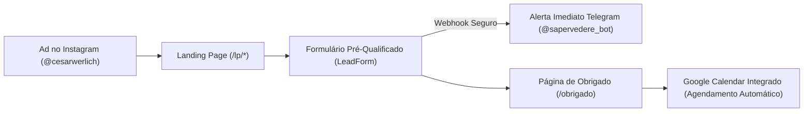

# Saper Vedere — Executive Board Campaign & Pipeline Masterplan

**Data**: 16 de Outubro de 2026  
**Autores**: Chief Sales Officer (CSO), Chief Marketing Officer (CMO), Chief Executive Officer (CEO)  
**Objetivo**: Aquisição Autônoma de Clientes B2B High-Ticket (Founders Pre-Seed a Series A) via Meta Ads (Instagram @cesarwerlich)

---

## 1. Visão Executiva: O Alinhamento da Mesa Diretora

### 🏛️ CEO: Disciplina Financeira, ROI e Unit Economics

> _"Não estamos aqui para colher curtidas de curiosos. Estamos operando uma consultoria executiva de Fractional COO cujo contrato típico vale de R$ 10.000 a R$ 25.000 / mês (LTV de R$ 120k a R$ 300k). Cada centavo alocado em anúncios deve visar exclusivamente abrir conversas com fundadores qualificados de tecnologia."_

- **Orçamento de Teste Inicial**: R$ 20,00 / dia (~R$ 600,00 / mês).
- **Meta de Pipeline (30 dias)**:
  - 10 a 18 leads pré-qualificados (Founders B2B SaaS, 5 a 50 funcionários).
  - 5 a 8 reuniões de diagnóstico realizadas.
  - 1 a 2 propostas executivas na mesa.
  - **1 fechamento** = Retorno imediato de **20x a 40x sobre o investimento anual de mídia**.

---

### 🎨 CMO: Arquitetura de Mensagem & Teste de 3 Ângulos

> _"O fundador de startup no Instagram sofre de cegueira de anúncios. Ele ignora jargões genéricos. Para capturar a atenção dele, atacamos onde dói: a dependência operacional do fundador, a ineficiência de processos que a IA já resolve, ou o desperdício de caixa antes da próxima rodada."_

#### Ângulo 1: Dores Operacionais (O Teste das Férias)

- **LP Destino**: [`https://sapervedere.com.br/lp/operacoes`](https://sapervedere.com.br/lp/operacoes)
- **Criativo**: `feed-1.png` (Feed 1:1) / `story-1.png` (Story 9:16)
- **Hook**: _"Se você tirar 14 dias de férias hoje, sua startup cresce ou tudo trava no seu WhatsApp?"_
- **Tese**: O fundador é o principal gargalo da própria empresa. Atuamos como Fractional COO para estruturar rotina executiva e destravar delegação.

#### Ângulo 2: Eficiência & GTM com Agentes de IA

- **LP Destino**: [`https://sapervedere.com.br/lp/gtm`](https://sapervedere.com.br/lp/gtm)
- **Criativo**: `feed-2.png` (Feed 1:1) / `story-2.png` (Story 9:16)
- **Hook**: _"Por que gastar R$ 25k/mês em tarefas manuais que Agentes de IA rodam em 30 segundos?"_
- **Tese**: Construção de máquina de Outbound previsível com infraestrutura moderna de automação e prospecção técnica.

#### Ângulo 3: Diagnóstico Tático de 14 Dias (Raio-X de Caixa e Funil)

- **LP Destino**: [`https://sapervedere.com.br/lp/diagnostico`](https://sapervedere.com.br/lp/diagnostico)
- **Criativo**: `feed-3.png` (Feed 1:1) / `story-3.png` (Story 9:16)
- **Hook**: _"14 dias para mapear todos os gargalos da sua operação antes da próxima rodada de captação."_
- **Tese**: Auditoria expressa para empresas que acabaram de captar ou estão preparando o Seed/Series A.

---

### 💼 CSO: Máquina de Vendas & SLA de Resposta em 5 Minutos

> _"Lead B2B esfria em 1 hora. Toda a infraestrutura técnica já foi construída para que o Cesar receba o lead mastigado no celular no segundo em que o formulário for preenchido."_

#### O Funil de Conversão em 3 Etapas:

#### Playbook de Fechamento do CSO:

1. **Se o lead agendou direto no Calendar**:
   - Cesar recebe a notificação no Google Calendar + ficha completa no Telegram.
   - Preparação de 10 min: Checar o LinkedIn do fundador e o site da empresa.
   - Reunião de 30 min: Diagnóstico consultivo (perguntar sobre o gargalo assinalado no formulário, apresentar a metodologia Saper Vedere, propor o Sprint de 14 dias ou Fractional COO).
2. **Se o lead enviou o formulário mas NÃO escolheu horário no Calendar**:
   - Em até 30 minutos, enviar uma mensagem direta pelo WhatsApp corporativo:
     > _"Oi [Nome], vi aqui seu diagnóstico na Saper Vedere sobre o desafio de [Desafio assinalado na LP]. Quero te economizar tempo: você tem 15 minutos livres amanhã de manhã ou à tarde para batermos um papo rápido sobre como destravar isso?"_

---

## 2. Status dos Ativos de Infraestrutura (Executado)

| Ativo                            | ID / Referência                               | Status                                                          |
| :------------------------------- | :-------------------------------------------- | :-------------------------------------------------------------- |
| **Campanha Criada**              | `120257341252230715`                          | ✅ Criada no Meta Ads Manager                                   |
| **Conjunto de Anúncios (AdSet)** | `120257344150960715`                          | ✅ Criado via Graph API (R$ 20/dia, Brasil, 25-65a, Advantage+) |
| **Pixel Meta**                   | `1071639049212230`                            | ✅ Instalado e ativo no Vercel                                  |
| **Perfil Instagram Anunciante**  | `@cesarwerlich` (`17841400788735649`)         | ✅ Vinculado à conta de anúncios                                |
| **Página do Facebook**           | `Saper Vedere` (`526108477419548`)            | ✅ Rebranded, Feed zerado, Capa e Logo ativos                   |
| **Biblioteca de Criativos**      | 6 Imagens Reais (Feed 1:1 + Stories 9:16)     | ✅ Carregadas com hash na conta                                 |
| **Notificações Telegram**        | `@sapervedere_bot`                            | ✅ Testado e conectado ao chat de Cesar                         |
| **Páginas de Destino (LPs)**     | `/lp/operacoes`, `/lp/gtm`, `/lp/diagnostico` | ✅ No ar e responsivas                                          |
| **Página de Conversão**          | `/obrigado` com Google Calendar embed         | ✅ No ar com tracking first-party                               |

---

## 3. Diretriz para o Usuário ("Não Preciso Fazer Nada")

O conselho executivo estruturou tudo para que o processo seja **100% autônomo**:

1. **Combustível da Máquina**:
   - A conta é pré-paga (`act_3144305875761286`). Basta adicionar saldo (R$ 50 ou R$ 100 via Pix no Ads Manager) para que o Meta libere a entrega.
2. **Entrega de Leads**:
   - Conforme os anúncios começarem a rodar, os dados dos fundadores qualificados e os horários agendados cairão diretamente no seu Telegram e Google Calendar.
